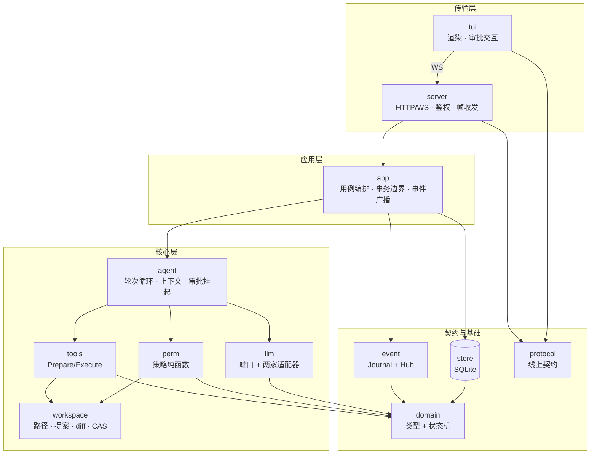
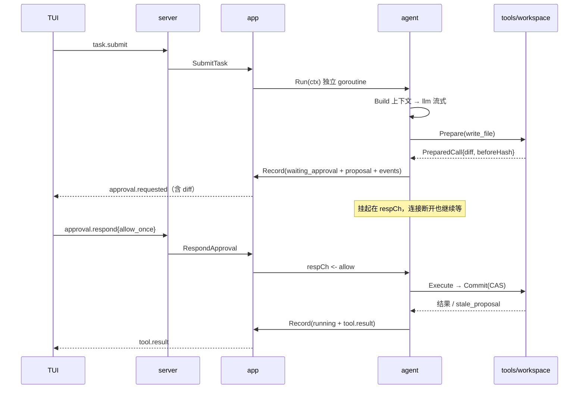

# jiaoag agent 架构

状态：v1 设计基线。M0（配置 / 协议 / 握手）已落地，M1 起按本文实施。
关联：`CONTEXT.md`、`docs/adr/0001`–`0008`。

---

## 1. 三条不变量

1. **会话事件流是历史事实的唯一来源**，数据库表是当前状态的投影；状态变更与它的事件在同一事务内写入。
2. **副作用只发生在「执行」阶段**；「准备」阶段必须能算出这次操作的全部后果（diff、argv、hash、风险等级）。审批因此是结构性的，不是流程约定。
3. **任务生命期与连接解耦**：连接断开任务照跑，重连按 seq 回放；任务的存活不依赖任何 socket。

---

## 2. 分层与依赖方向



依赖规则（违反即设计错误）：

| 规则 | 理由 |
|---|---|
| `domain` / `protocol` 只依赖标准库 | 两端与所有层共用，不能有实现泄漏 |
| `agent` 不得 import `store` / `server` / `tui` | 运行时与持久化、传输解耦；落库经 `Recorder` 接口 |
| `server` 不得 import `store` / `agent` | 传输层只经 `app`，否则用例逻辑会渗进 handler |
| `tools` 不 import `perm` | 工具只声明副作用类别，不决定是否需要审批 |
| `perm` 不 import `tools` / `agent` | 策略是纯函数，输入 `domain.PreparedCall` 即可穷举测试 |
| `tui` 只 import `protocol` / `config` | 客户端看不到服务端内部类型 |
| 接口声明在消费方 | `agent` 声明 `Recorder`（`app` 实现）；`event` 声明 `Journal`（`store` 实现） |

---

## 3. 包职责

| 包 | 职责 |
|---|---|
| `internal/domain` | Task / ToolCall / Approval / Proposal 的类型与合法迁移表；`PreparedCall`、`Decision`、`Transition` |
| `internal/protocol` | 信封与全部 C→S / S→C 载荷，**含事件载荷**（TUI 要解，属于线上契约） |
| `internal/event` | `Journal`（追加 / 回放）、`Hub`（按会话订阅与扇出）、seq 分配契约 |
| `internal/store` | SQLite 单一深模块：7 张表、事务助手、投影更新、审计写入；实现 `Journal` |
| `internal/llm` | `Provider` 端口 + openai / anthropic 适配器 + 重试 / 超时 / 限流装饰器 |
| `internal/workspace` | 工作区根、路径解析与越界防护、读、`Propose`（hash + diff）、`Commit`（CAS）、git 只读 |
| `internal/tools` | `Prepare` / `Execute` 契约、注册表、6 个工具实现 |
| `internal/perm` | 路径边界 → 工具分级 → argv 白名单 → 执行约束，逐层 fail-closed |
| `internal/agent` | 上下文装配、轮次循环、审批挂起 / 恢复、取消 |
| `internal/prompt` | 提示词分层装配（纯函数）、`{{var}}` 白名单替换、项目级确认与 hash（ADR-0012） |
| `internal/app` | 建会话、提交任务、响应审批、取消、订阅；唯一的事务与广播位置 |
| `internal/server` | 鉴权、帧编解码、连接注册、订阅桥接；无业务逻辑 |
| `internal/tui` | 渲染、输入、审批面板 |

---

## 4. 关键契约

### 4.1 Recorder / Transition（agent → app）

```go
// agent 侧声明；app 实现。agent 因此不认识 SQL。
type Recorder interface {
	Record(ctx context.Context, tr domain.Transition) error
}

type Transition struct {
	TaskID   string
	Status   domain.TaskStatus      // 迁移后的状态
	Tool     *domain.ToolCallUpdate // 可空
	Proposal *domain.Proposal       // 可空
	Events   []protocol.Envelope    // 不含 seq，由 app 在事务内分配
}
```

`app.Record` 的职责：开事务 → 更新投影 → 追加事件（分配 seq）→ 提交 → 向 `Hub` 广播。任一失败整体回滚，杜绝「事件有、记录无」。

### 4.2 PreparedCall（tools → perm → agent）

```go
type PreparedCall struct {
	ToolCallID string
	Tool       string
	Args       json.RawMessage // 归一化后的参数
	SideEffect SideEffect      // none | fs_write | process | network
	Risk       RiskLevel
	Paths      []string        // 解析后的绝对路径（路径边界检查用）
	Proposal   *Proposal       // 写类工具：before/after hash + diff
	Command    *CommandPlan    // 命令：argv、cwd、超时、env 白名单
}
```

### 4.3 Decision（perm 输出）

```go
type Decision struct {
	Verdict  Verdict // Auto | NeedsApproval | Denied
	Reason   string
	PolicyID string  // 写入审计，可回溯是哪条规则放行/拦截
}
```

---

## 5. 关键设计

### 5.1 事件日志 + 投影（ADR-0005）

纯事件溯源重建成本高、查询难写；只存表则无法回放与审计。取中间态：`events` 追加 + 投影表更新同事务。seq 为**会话内**单调递增，由 `sessions.last_seq` 在同事务自增。

流式增量**不入库**：只持久化 `assistant.start` 与 `assistant.message`，`assistant.delta` 带 seq 但不落盘，因此 seq **允许空洞**。客户端只要求「不重复、不乱序」，不要求连续。

### 5.2 工具两段式 Prepare / Execute（ADR-0006）

`Prepare` 纯只读（读现状、算 hash、算 diff、解析 argv），`Execute` 才动磁盘 / 起进程。审批插在两段之间。`Execute` 前还会重算一次目标文件 hash（CAS），不一致返回 `stale_proposal` 作为工具结果交回模型，让它重新读、重新提案——并发写同一文件因此不需要互斥锁。

### 5.3 任务运行时与连接解耦（ADR-0007）

`agent.Run(ctx, taskID)` 在独立 goroutine；需要审批时落库 `waiting_approval` 并阻塞在

```go
select {
case d := <-respCh:      // app.RespondApproval 投递
case <-ctx.Done():      // 取消 / 服务端关闭
}
```

启动恢复：`running` → `interrupted`，`waiting_approval` → `expired`，v1 不自动续跑。审批**不设超时**，只能人工取消。

### 5.4 权限是纯函数（ADR-0004）

四层顺序固定、任一失败短路、禁止「先清洗再匹配」。决策结果连同 `PolicyID` 原样写入审计。

### 5.5 LLM 端口 + 装饰器（ADR-0008）

```go
type Provider interface {
	Chat(ctx context.Context, req Request) (Response, error)
}
type Streamer interface {
	ChatStream(ctx context.Context, req Request, fn func(Chunk) error) error
}
```

适配器只做协议翻译（消息 / 工具 / 流式 / usage），重试、退避、超时、限流在装饰器里组合：`provider → retry → timeout`。流式统一为 `Chunk{TextDelta, ToolCallDelta, Usage, Done}`。

### 5.6 上下文装配是纯函数

```go
func Build(system string, history []domain.Message, budget int) []domain.Message
```

v1 只做确定性截断：单个工具结果超 8 KB 换成「已截断，全文见 outputs/…」+ 首尾片段；保留最近 N 轮；总字符超预算从最旧轮开始丢，system 与最近一条 user 消息永不丢。预算单位是 **UTF-8 字符数**（无依赖、可测），token 精算留到 v2。

---

## 6. 主流程

### 6.1 写文件 → 审批 → 落盘



### 6.2 断连 → 重连回放

客户端发 `event.subscribe{session_id, from_seq}`，服务端顺序必须是：

1. **先订阅**（新事件进入缓冲）
2. 回放 `from_seq .. last_seq`
3. 刷缓冲（按 seq 去重）

反序会漏事件。`from_seq` 之后的既有事件由 `store.Replay` 提供。

---

## 7. 并发与状态所有权

| 关注点 | 归属 |
|---|---|
| 任务状态迁移 | 只由 `agent` 决定，经 `Recorder` 落库 |
| 事务 / seq / 广播 | 只在 `app`（唯一写者） |
| 会话内并发 | **一个会话最多一个 running 任务，其余 `queued` 排队**（上下文不交错，seq 单写者） |
| 跨会话并发 | 不设上限；provider 限流放装饰器 |
| 取消 | ctx 树：server → task → round → tool；`select` 覆盖审批等待与流式读 |
| 崩溃兜底 | 每个任务 goroutine `recover` → `failed{internal}`，不影响其他任务 |

---

## 8. 错误与可观测性

- 各层返回类型化错误（`perm.DeniedError`、`workspace.ErrStale`、`llm.ErrRateLimited`），只在 `app` 边界映射成 `protocol` 错误码。
- 每次工具调用写一行 `audit`：tool、原始参数 / argv、cwd、策略 ID 与判定、审批来源、耗时、退出码、输出 hash。
- 事件流本身即 trace：一轮 = `message.start → tool.requested → approval.* → tool.result → message.completed`。

---

## 9. v1 不做

容器隔离、上下文摘要压缩、MCP、websearch、多模态 / reasoning、重启续跑、审批超时、跨会话共享上下文、并行工具执行（v1 串行，审计顺序清晰）。

---

## 10. 里程碑映射

| 里程碑 | 架构落点 |
|---|---|
| M1 | `domain` + `event` + `store` + `app` 骨架（会话 / 任务入库，暂不跑） |
| M2 | `llm` 端口 + 两个适配器 + 流式归一化 + 装饰器 |
| M3 | `tools`(read/grep/glob) + `agent` 循环（只读，无审批） |
| M4 | `workspace` 提案 / diff / CAS + 审批挂起恢复（最易低估的纵向切片） |
| M5 | `run_command` + `perm` 全量 + `audit` |
| M6 | 多会话排队、断连回放、`interrupted` / `expired` 恢复 |

---

## 11. 已定分叉

| # | 分叉 | 结论 |
|---|---|---|
| 1 | 会话内多任务 | 排队，串行 |
| 2 | 流式 delta 入库 | 不入库，只存 start / message，seq 允许空洞 |
| 3 | 上下文预算单位 | UTF-8 字符数 |
| 4 | 审批超时 | 不超时，只能人工取消 |

---

## 12. 扩展点

原则：**只在边缘扩展（工具 / 供应商 / UI / 规则数据 / 压缩策略），不碰不变量（事件日志、审批、权限引擎）**。详见 ADR-0009、ADR-0010、ADR-0011。

一个能力缺口要同时满足三条才做成插件：①外部在快速变化（CVE / 包生态 / 模型 / 语言工具链），内置必然落后；②失败可降级，不破坏三条不变量；③宿主能验证其输出（schema 校验、签名、diff + CAS、argv 审计）。缺任一条就不是扩展，是把边界外包。

验证强度分三级（A 可计算 / B 可结构 / C 仅可记录），C 级只影响质量、不得参与安全判定，且必须能一键回默认。新增扩展点须过 ADR-0009 的六问准入清单；**留缝不等于实现**——字段缝 v1 就留，加载器与进程协议等第一个真实实现再定型。每个 task 记 `extensions_digest`（工具集版本 + 规则集 hash + backend + `system_prompt_hash`），一眼回答「这一轮由哪套扩展组合跑出来」。

| 扩展点 | 可插？ | 机制 | 时间 |
|---|---|---|---|
| 工具 | ✅ | `tools.Source`：builtin / MCP / stdio 插件 | v1 留缝，v2 运行时 |
| LLM 供应商 | ✅ | 按 `config.type` 构造，v1 switch → v2 注册表 | v2 |
| UI | ✅ | 协议客户端，Web / 移动端即另一个 WS 客户端 | 已成立 |
| 事件消费者 / 审计导出 | ✅ | 订阅事件流 | v2 |
| 上下文压缩策略 | ✅ 仅进程内 | `agent.Compactor` | v1 接口 + `TruncateOldest` |
| 提示词（系统提示 / 项目知识） | ⚠️ 仅追加 | `prompt.Assemble` + 项目级确认与 hash（ADR-0012） | v1 |
| 工具描述 / 压缩提示 | ❌ | 调用契约与上下文完整性，属代码不属配置 | 不开放 |
| 权限规则数据 | ⚠️ 只能收紧 | `perm.Loader` + `TightenRule` | v1 本地规则，v2 签名 feed |
| 执行后端（sandbox / 远程 runner） | ✅ 仅宿主选择 | `ExecBackend`，工具无权指定（ADR-0011） | v1 只有 `direct`，v2 加实现 |
| 权限判定逻辑 | ❌ | 唯一安全边界（ADR-0001） | 不开放 |
| 事件日志 / 状态机 / 审批流程 | ❌ | 三条不变量 | 不开放 |
| 存储后端 | ❌ | SQLite 够用，抽象会拖慢 M1 | 不预留 |

### 12.1 工具 Source

```go
type Source interface {
	Name() string
	Tools(ctx context.Context) ([]Tool, error)
	Close() error
}

type Spec struct {
	Name        string
	Description string
	Schema      json.RawMessage // JSON Schema，跨语言通用
	Source      string          // builtin | mcp:foo | plugin:bar
	Effects     []Effect        // read | propose_write | process | network
}
```

MCP 不是独立特性，而是 `Source` 的一个实现；v2 的外部插件是第二个实现（stdio JSON-RPC 2.0）。

**宿主中介写盘**：`propose_write` 只返回 `{path, content}`，diff / hash / 审批 / CAS 落盘全由宿主做；`process` / `network` 必审批并回报 argv / 目标。审计行必须带 `source`。插件是受信代码，不是沙箱（ADR-0001），一插件一进程，崩溃只影响该 Source。

### 12.2 压缩策略

```go
type Compactor interface {
	Name() string
	Compact(ctx context.Context, in CompactInput) (CompactOutput, error)
}

type CompactInput struct {
	System  []Message
	History []Message // 时间正序，含本轮 user
	Budget  int       // UTF-8 字符数（v1）
	LLM     llm.Provider
	Audit   func(CompactionAudit)
}

type CompactOutput struct {
	History []Message
	Summary string
}
```

宿主保留三条硬约束：返回后**二次校验预算**（超限回退 `TruncateOldest` 并记 `strategy_fallback`）；**保留项不可丢**（system、最近一条 user、本轮工具结果）；**结果只缓存不入库**——`compactions(session_id, from_seq, to_seq, strategy, version, summary, created_at)`，按 seq 区间复用，避免同一段历史出现两个摘要版本。

摘要策略的两个坑：摘要本身是 LLM 调用，必须带 `noCompact` 标记防止递归，并有独立超时（20s），失败回退丢弃；它不属于会话事实，只写审计（`kind=context.compact`，带策略名、节省字符数、耗时），不产生 `assistant.message` 事件。

### 12.3 权限规则热更新

规则集是不可变快照 `Ruleset{Version, Hash, Rules}`，`Loader` 产出新快照后原子替换；`perm.Decision.PolicyVersion` 入审计。外部 `TightenRule` 只能返回 `NeedsApproval` / `Denied`，引擎无降级为 `Auto` 的路径——放宽必须人工改本地配置。

`waiting_approval` 期间规则更新时，审批应答到达必须用当前快照重算：新规则 `Denied` → 提案作废返回 `policy_changed`；仍需审批 → 继续等待并提示理由变更；不再需审批 → **不采纳自动放行**，按原审批走完。

### 12.4 能力缺口与开放顺序

做不极致的能力，就是最值得开放的地方——但形态要选对。

| 能力 | 为什么做不到极致 | 扩展形态 |
|---|---|---|
| 代码理解 | grep / glob 只做文本匹配：不懂 interface 满足关系、类型流、调用图；agent 的瓶颈八成在这里 | `tools.Source`：LSP 客户端、tree-sitter、semgrep、codegraph |
| 命令后果判断 | argv 白名单只判「长什么样」，判不了「会发生什么」：`make` 里的 `curl \| sh`、npm postinstall、git hooks | 规则数据 + 命令重写器 + 执行包装器 |
| 执行隔离 | 无容器（ADR-0001），命令与 server 同权限 | `ExecBackend`（ADR-0011），仅宿主选择 |
| 供应链与时事 | 包昨天有没有被投毒、今天有没有 CVE，代码里推不出来 | 签名 feed（与 ADR-0010 同一管道） |
| 上下文与长期记忆 | 截断只是止血；语义压缩、跨会话项目记忆做不好 | `Compactor` + 记忆检索插件 |
| 模型能力 | 只适配两家协议；没有按任务选模型、本地推理、token 精算 | 供应商适配器 + 路由策略 + tokenizer |
| 多仓库 / monorepo | 单 workspace 边界，跨仓库重构做不深 | workspace provider（多根、worktree 池） |
| 呈现与人机协作 | TUI 只有文本；无 hunk 级局部批准、无移动端审批 | 协议客户端 + 审批呈现层 |
| 通知 / 集成 | Slack、PR 评论、编辑器接入不属服务端职责 | 事件消费者（只读，零风险） |
| 合规解读 | 能记原始事实，判不了「这次变更加了 PII」 | 审计后处理器（只读） |

开放顺序按「收益 / 风险」而不是「炫技程度」：

| 优先 | 缺口 | 理由 | 成本 |
|---|---|---|---|
| P0 | 代码理解（LSP / tree-sitter） | 直接决定 agent 好不好用；工具类风险最低 | ~3–5 天 |
| P1 | 执行后端（sandbox-exec / bwrap） | 唯一能实质降低 ADR-0001 风险的办法 | ~2–3 天 |
| P2 | 供应链 feed | 复用 ADR-0010 的签名管道，边际成本最低 | ~1 天 |
| P3 | 记忆 / 压缩策略 | 缝已留，等真实上下文压力再上 | ~2–3 天 |
| P4 | UI / 通知 | 协议已定，零架构成本 | 各自独立 |

三条不许破：插件的输出必须可被宿主验证；插件不得成为运行前提（缺失时核心功能照常）；插件的身份（`source` / `backend` / feed `version`）必须进审计。

### 12.5 提示词装配

五类 prompt 分治，只有两类开放：系统提示与项目知识可追加；工具描述与压缩提示锁定（调用契约与上下文完整性属代码）；审批话术不开放（可被用来诱导绕过审批）。

```go
func Assemble(layers []Layer, vars map[string]string) (Result, error)

type Segment struct {
	Source string // builtin:core | user:system.md | project:.jiaoag/prompts/10-rules.md | tool:mcp:foo
	Kind   string // core | system | tools | fragment
	Text   string
}
```

三条底线：**核心段不可覆盖只能追加**（工具协议、审批规则、workspace 边界、OS / shell / 时间由宿主注入）；**工具描述只追加**；**项目级 prompt 首次需确认**（路径 + 摘要 + 是否 git 跟踪，记 hash，变更重确认，未确认不加载）。

变量白名单 `{{workspace}} {{os}} {{shell}} {{git_branch}} {{date}} {{model}} {{tools}}`，未定义直接报错，不引入逻辑。每个 task 取一次快照，`prompt_hash` 与分段来源写进 task 行与审计，会话中途改文件不影响在跑任务（也避免 prompt cache 失效）。`jiaoag prompt show` / `prompt check` 用于确认实际发出的内容。

**会话级不是一层**：会话只提供作用域，项目级在该会话创建时已自动装配。确需差异时用「会话附加」（`sessions.prompt_append`，仍只追加，`session.update_prompt` 写入并审计），v1 不实现。确认粒度按 `workspace + hash` 记在数据目录的 `prompt_trust`，不按会话，否则每个新会话都要确认一次。详见 ADR-0012。
