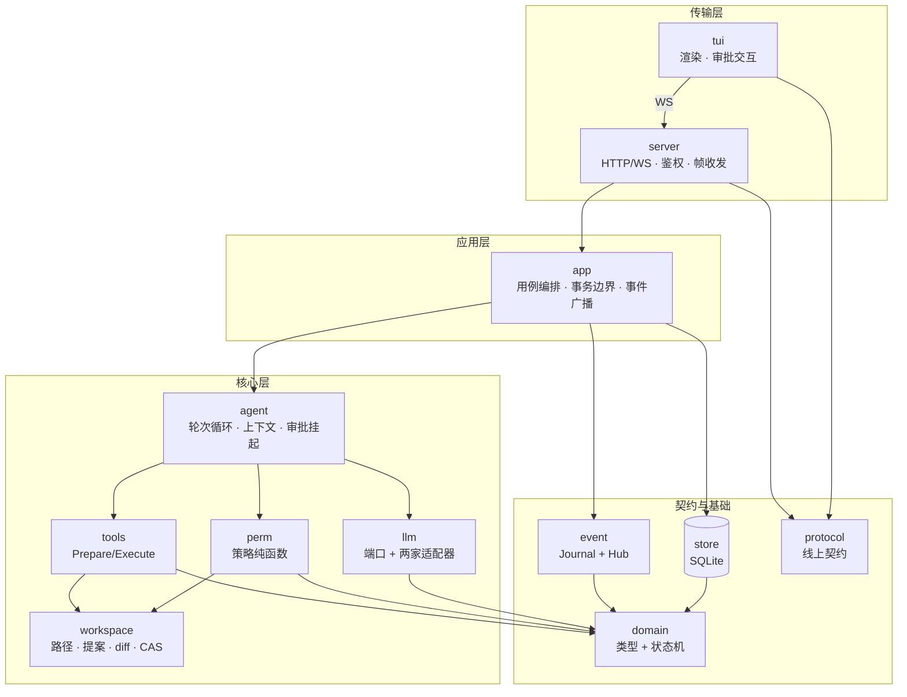
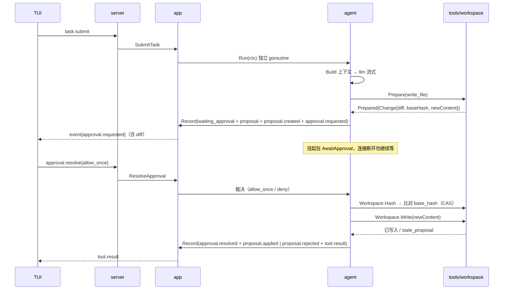

# jiaoag agent 架构

状态：v1 设计基线。M0–M6 已落地；本文描述的是当前实现。
关联：`CONTEXT.md`、`docs/adr/0001`–`0013`。

---

## 1. 三条不变量

1. **会话事件流是历史事实的唯一来源**，数据库表是当前状态的投影；状态变更与它的事件在同一事务内写入。
2. **副作用只发生在「执行」阶段**；「准备」阶段必须能算出这次操作的全部后果（diff、argv、hash、风险等级）。审批因此是结构性的，不是流程约定。
3. **任务生命期与连接解耦**：连接断开任务照跑，重连按 seq 回放；任务的存活不依赖任何 socket。

---

## 2. 分层与依赖方向



依赖规则（违反即设计错误）：

| 规则 | 理由 |
|---|---|
| `domain` / `protocol` 只依赖标准库 | 两端与所有层共用，不能有实现泄漏 |
| `agent` 不得 import `store` / `server` / `tui` | 运行时与持久化、传输解耦；落库经 `Recorder` 接口 |
| `server` 不得 import `store` / `agent` | 传输层只经 `app`，否则用例逻辑会渗进 handler |
| `tools` 不 import `perm` | 工具只声明副作用类别，不决定是否需要审批 |
| `perm` 只 import `tools` | 策略是纯函数：读工具声明的 `Spec` / `Effect` 分级，不 import `agent` / `app`，可穷举测试 |
| `tui` 只 import `domain` / `protocol` / `patch` / `version` | 客户端只解线上载荷与 diff 统计，看不到服务端内部类型（`store` / `agent` / `app`） |
| 接口声明在消费方 | `agent` 声明 `Recorder`（`app` 实现）；`event` 声明 `Journal`（`store` 实现） |

---

## 3. 包职责

| 包 | 职责 |
|---|---|
| `internal/domain` | Task / ToolCall / Approval / Proposal 的类型与合法迁移表；`Transition`、`Decision`、`ApprovalSource` |
| `internal/limits` | 跨层硬上限的唯一出处：`MaxPayloadBytes`（256 KB），由 `patch` 与 `tools` 各自引用 |
| `internal/patch` | 纯计算：sha256 摘要、换行风格归一、unified diff（超 `MaxDiffBytes` 截断并按 UTF-8 边界回退） |
| `internal/protocol` | 信封与全部 C→S / S→C 载荷，**含事件载荷**（TUI 要解，属于线上契约） |
| `internal/event` | `Journal`（追加 / 回放）、`Hub`（按会话订阅与扇出）、seq 分配契约 |
| `internal/store` | SQLite 单一深模块：7 张表、事务助手、投影更新、审计写入；实现 `Journal` |
| `internal/llm` | `Provider` 端口 + openai / anthropic 适配器 + 重试 / 超时 / 限流装饰器 |
| `internal/workspace` | 工作区根、路径解析与越界防护、读、`Snapshot` / `Hash`、`Write`（同目录临时文件 + rename，保留权限；拒绝二进制 / `.git` / 符号链接） |
| `internal/tools` | `Prepare` / `Execute` 两段式契约、注册表与 256 KB 输出收敛；11 个内置工具（read_file / grep / glob / write_file / edit_file、run_command / check_command、read_output、git_status / git_diff / git_log）加可选的 remember / skill |
| `internal/exec` | 执行后端（ADR-0011）：`Plan` 校验、进程组 / Job Object 与超时 / 取消杀组、资源上限、头尾截断与全文日志（`Spec` 三档预算） |
| `internal/perm` | 按工具副作用分级、默认拒绝；M5 已叠加参数级 argv 白名单与执行约束（ADR-0004） |
| `internal/agent` | 上下文装配、轮次循环、审批挂起 / 恢复、取消 |
| `internal/prompt` | 提示词分层装配（纯函数）、`{{var}}` 白名单替换、层来源与 hash（ADR-0012、ADR-0025） |
| `internal/app` | 建会话、提交任务、响应审批、取消、订阅；唯一的事务与广播位置 |
| `internal/server` | 鉴权、帧编解码、连接注册、订阅桥接；无业务逻辑 |
| `internal/tui` | 渲染、输入、审批面板；`!命令` 经 `internal/localshell` 在客户端执行（ADR-0022） |
| `internal/localshell` | 客户端本机命令：`sh -c` / `cmd /c`、按行流式回传、单行裁剪、超时与整组杀进程 |
| `internal/skills` | 技能包发现与按需加载：扫描 `SKILL.md`、容错解析 frontmatter、只把索引交给提示词、正文由 `skill` 工具取或经用户 `/skill` 指定后直接注入（ADR-0023、ADR-0024） |
| `internal/project` | 项目级扩展发现：根 `AGENTS.md`、`.jiaoag/prompts/*.md`、`.jiaoag/skills` 与 `.agents/skills`、`.jiaoag/mcp.yaml`；产出内容摘要（ADR-0025） |
| `internal/memory` | 跨会话记忆：工作区 `MEMORY.md` 的读取、截断与提示层包装（ADR-0018） |
| `internal/mcp` | MCP stdio 客户端与工具源：连接缓存、命名清洗、`tools.include/exclude` 过滤、外部工具审批与状态快照（ADR-0014、ADR-0025） |
| `internal/plugin` | 第三方 stdio 插件宿主：换行分隔 JSON-RPC，插件只声明副作用意图，写入/命令/外部调用由宿主中介（ADR-0034） |
| `internal/policyfeed` | 签名规则 feed：ed25519 验签、有效期与回滚检查、原子落盘（ADR-0032） |
| `internal/notify` | Webhook 通知：审批与任务终态，异步有界队列、重试与 HMAC 签名（ADR-0035） |
| `internal/webui` | Web 前端：原生页面 + `go:embed`，同源挂在 `/`，复用同一套 WS 协议；静态资源公开、数据接口校验令牌（ADR-0041） |
| `internal/cli` | 命令行子命令的实现（`serve` / `tui` / `sessions` / `events` / `policy` / `demo` / `plugin-example`），由唯一的 `cmd/jiaoag` 按子命令分发；各包导出 `Main()`，仍按 `os.Args` 解析参数 |

---

## 4. 关键契约

### 4.1 Recorder / Transition（agent → app）

```go
// agent 侧声明；app 实现。agent 因此不认识 SQL。
type Recorder interface {
	Record(ctx context.Context, tr domain.Transition) error
	// 读回会话历史，用来重建模型上下文。
	Events(ctx context.Context, sessionID domain.SessionID) ([]domain.Event, error)
	// 流式增量：seq=0 的临时帧，不落库、不进回放。
	Delta(ctx context.Context, ev domain.Event) error
	// 阻塞到审批被裁决；ctx 取消返回 ctx.Err()，审批不设超时。
	AwaitApproval(ctx context.Context, req ApprovalRequest) (ApprovalResult, error)
}

type Transition struct {
	TaskID   domain.TaskID
	To       domain.TaskStatus  // 非空时才做任务迁移
	Reason   string             // 失败 / 取消原因
	ToolCall *domain.ToolCall   // 可空：这次调用的整份投影（每次覆盖写回）
	Approval *domain.Approval   // 可空
	Proposal *domain.Proposal   // 可空
	Usage    *domain.TokenUsage // 可空：本轮增量，累加写回
	Audit    []domain.AuditRecord
	Events   []domain.Event // 不含 seq 与时间，由 store 在事务内分配
}
```

`app.Record` 的职责：开事务 → 校验迁移 → 更新投影 → 追加事件（分配 seq）→ 提交 → 向 `Hub` 广播。任一失败整体回滚，杜绝「事件有、记录无」。

审批的载荷单独定义，`agent` 只交参数原文，不去查工具调用表：

```go
type ApprovalRequest struct {
	SessionID  domain.SessionID
	ApprovalID domain.ApprovalID
	Tool       string
	Args       json.RawMessage // 参数原文：allow_session 的摘要键
}

type ApprovalResult struct {
	Decision domain.Decision       // allow_once | allow_session | deny
	Source   domain.ApprovalSource // user | policy（system 只出现在收尾事件）
	Note     string
}
```

### 4.2 Prepared（tools → perm → agent）

```go
type Prepared struct {
	Call  Call     // 原始调用：id / name / args
	Spec  Spec     // 工具声明的副作用与 JSON Schema
	Args  any      // 已校验的参数结构体，Execute 里断言
	Paths []string // 解析后的绝对路径（日志与权限判定用）
	Change *Change // 仅写入工具：一次「还没发生的写入」
}

// 写入工具的提案载荷。Prepare 阶段算好，审批通过后才落盘。
type Change struct {
	Path       string // 工作区相对路径
	Exists     bool   // 决定 diff 头是 /dev/null 还是 a/<path>
	BaseHash   string // 原文件 sha256；新建文件为空串
	NewHash    string
	NewContent []byte // 已按原文件换行风格还原
	Diff       string // unified diff，超 MaxDiffBytes 截断
	Truncated  bool
}
```

`Prepare` 不产生任何副作用：未知工具、参数错、越界路径、二进制/符号链接目标都在这一步降级成工具错误，回给模型自己纠正。

### 4.3 Decision（perm 输出）

```go
type Verdict string

const (
	Allow       Verdict = "allow"        // 只读工具：自动放行，仍入审计
	RequireUser Verdict = "require_user" // 写入 / 未知副作用：必须人工裁决
)

type Decision struct {
	Verdict Verdict
	Reason  string // 写进 tool.prepared 与界面：为什么放行 / 为什么要问
}
```

判定顺序短路：声明 `propose_write` → 必审批；本地收紧规则 → 必审批（先于只读短路）；只有 `read` → 放行；其余（`process` / `network` / 未声明）→ 必审批。`PolicyVersion` / `RuleID` 已随 M5 的命令白名单进入审计。

---

## 5. 关键设计

### 5.1 事件日志 + 投影（ADR-0005）

纯事件溯源重建成本高、查询难写；只存表则无法回放与审计。取中间态：`events` 追加 + 投影表更新同事务。seq 为**会话内**单调递增，由 `sessions.last_seq` 在同事务自增。

流式增量**不入库**：只持久化 `assistant.start` 与 `assistant.message`，`assistant.delta` 是 **seq=0 的临时帧**（不占 seq、不进回放、不参与去重）。客户端的判据因此很直接：seq>0 是历史事实，seq=0 是「正在生成」的临时状态，收到 `assistant.message` 后以完整文本替换。

### 5.2 工具两段式 Prepare / Execute（ADR-0006）

`Prepare` 纯只读（读现状、算 hash、算 diff、解析 argv），`Execute` 才动磁盘 / 起进程。审批插在两段之间：准备产物 `Prepared.Change` 非空时，顶层不调 `Execute`，而是走「提案 → 审批 → CAS 落盘」。写入工具的 `Execute` 因此**失败关闭**——绕过审批直接调用只会得到「必须经过审批」的错误，落盘只有 `agent → workspace.Write` 一条路径（临时文件 + `rename`，保留原权限）。

审批协议只有一条投递路径：C→S 的 `approval.resolve`，裁决结果由 `approval.resolved` 事件回传；提案没落盘的三种结局（拒绝 / 失效 / 写失败）统一记 `proposal.rejected{status}`（ADR-0013）。

CAS 发生在批准之后、落盘之前：重算目标文件 sha256 与提案 `base_hash` 比对，不一致返回 `stale_proposal` 作为工具结果交回模型，让它重新读、重新提案——并发写同一文件因此不需要互斥锁。

裁决可以只覆盖部分块（ADR-0028）：`approval.resolve.hunks` 给 0 起下标时，服务端用 `patch.ApplyHunks` 从磁盘旧内容逐块重放，未选块保持原样，重算 `new_hash` 后落盘，并在 `proposal.applied` / `write.applied` 里记下块号。`allow_session` 与 `hunks` 同时出现时降级为 `allow_once`——白名单放行的是「整份写入」，不是「这次只写第二块」。

`allow_session` 的授权从 v2.18 起落 `session_approvals` 表（`session_id + 工具/参数摘要` 主键，`expires_at` 默认 12 小时，`agent.approval_ttl` 可调，ADR-0030）：重启后同会话同类调用不再询问；读取时按 `expires_at` 判定，读失败按未授权处理（fail closed），写入时顺手清理过期行。

写入目标必须是**普通文件**：目标本身是符号链接时 `Snapshot`/`Write` 一律拒绝。`rename` 替换的是链接自身，而 diff 是按链接指向的内容算的，放行一次就是「批准的和落盘的」两件事。同理，行级 diff 表达不了的改动（新建空文件、只差结尾换行）在 `Prepare` 阶段就拒绝——空 diff 进审批等于让用户盲批。

### 5.3 任务运行时与连接解耦（ADR-0007）

`agent.Run(ctx, task)` 在独立 goroutine；需要审批时落库 `waiting_approval` + 提案并阻塞在 `Recorder` 上：

```go
select {
case d := <-wait.ch:     // app.ResolveApproval 投递
case <-ctx.Done():       // 取消 / 服务端关闭
}
```

审批**不设超时**，只能人工取消。取消时 agent 用 `context.WithoutCancel` 把审批收尾成 `expired`（`source=system`）、提案转 `stale` 并补一条 `proposal.rejected`、工具调用标 `canceled` 并补一条 `status=canceled` 的 `tool.result`——不能留下永远等不到裁决的 `pending`，也不能让回放看到一条永远 pending 的提案、停在 `waiting_approval` 的调用，或没有回填的 `tool_use`（那会让下一次请求被供应商拒绝）。

`allow_session` 只是内存里的会话白名单，键为 `sha256(tool + "\x00" + args)`；命中仍记 `approval.resolved{source: policy}`。v1 没有「会话结束」事件，因此白名单的实际生命周期是**进程内**：退出即清空，不落盘、不跨连接继承（ADR-0007 的运行时与连接解耦不改变这一点）。进程重启时 `app.ConfigureRuntime` 调用 `ExpirePendingApprovals`：遗留审批标 `expired`、提案标 `stale` 并记 `proposal.rejected`、对应的工具调用标 `canceled`、没有协程在跑的任务标 `canceled`；**`queued` 任务例外**：`agent.resume_queued`（默认开启）下它们保持 `queued`，重启后由 `resumeQueuedTasks` 重建队列继续跑（ADR-0017）。执行中/等审批的任务不自动重跑——它们可能已经产生副作用，重跑会重复执行工具。紧接着 `ReapUnfinished` 兜住其余没有 `tool.result` 的调用：停在 `requested|prepared|waiting_approval|running` 的一律标 `canceled` 并补一条结果；**已经裁决过审批的那批也补**，文案写成「执行中进程重启，结果未知」——它们大概率已经开始执行，但结果无从判断。不补的话回放出的历史带着孤立的 `tool_use`，下一次请求会被供应商拒绝，会话直接不可用。`CheckApprovalConsistency` 只留作补写失败时的安全网。

### 5.4 权限是纯函数（ADR-0004）

层序固定、任一失败短路、禁止「先清洗再匹配」。M4 落地了 `workspace.Resolve` 的路径边界与工具副作用分级；M5 把判定入口换成 `Ruleset.Evaluate`：写入/本地收紧 → 只读 → 命令白名单（程序名必须与 `argv[0]` 完全一致 + 子命令 + flag 白名单 + 路径参数必须在工作区内）→ 默认审批。`go build` 与 git 子命令不在命令白名单里：前者会写工作区产物，后者会执行仓库配置里的外部程序（专用 git 工具已注入 `core.fsmonitor=false` 与 `--no-ext-diff --no-textconv`）。`Decision` 的 `PolicyVersion` / `RuleID` 随 `exec.*` 审计一起落库。模型的 shell 需求走显式 `shell` 字段（ADR-0038）：整条命令由 `sh -c` / `cmd /c` 解释，固定要审批，理由写作 `shell: …`，不再借用元字符判定给模型的行为贴错标签。

### 5.5 LLM 端口 + 装饰器（ADR-0008）

```go
type Provider interface {
	Chat(ctx context.Context, req Request) (Response, error)
}
type Streamer interface {
	ChatStream(ctx context.Context, req Request, fn func(Chunk) error) error
}
```

适配器只做协议翻译（消息 / 工具 / 流式 / usage），重试、退避、超时、限流在装饰器里组合：`provider → retry → timeout`。流式统一为 `Chunk{TextDelta, ToolCallDelta, Usage, Done}`。

### 5.6 上下文装配是纯函数

```go
// agent.Build：把完整历史压进预算，返回可直接发给供应商的消息。
func Build(history []llm.Message, budget int) []llm.Message
```

v1 只做确定性截断：单条工具结果超 8 KB 折成「首 4 KB + 尾 2 KB」（中间换成省略提示，正文不另存）；裁剪按**轮**进行——从最旧的一条 user 消息丢到下一个 user 消息之前，避免留下孤立的 tool_result；system 单独装配进请求，不参与这次预算；最后一条 user 消息永不丢（预算不够时宁可超一点）。预算单位当时是 **UTF-8 字符数**（无依赖、可测）；v2.19 改为**估算 token**：按字符类别加权估算，并用每轮 `prompt_tokens` 在线校准系数（ADR-0031）。

---

## 6. 主流程

### 6.1 写文件 → 审批 → 落盘



### 6.2 断连 → 重连回放

客户端发 `event.subscribe{session_id, from_seq}`，服务端顺序必须是：

1. **先订阅**（新事件进入缓冲）
2. 回放 `from_seq .. last_seq`
3. 增量订阅（`from_seq > 0`）补一帧 `event.snapshot`：仍待裁决的 `approval.requested` 原始载荷
4. 刷缓冲（按 seq 去重）

反序会漏事件。`from_seq` 之后的既有事件由 `store.Replay` 提供。

TUI 记录已收到的最后一条持久事件序号 `lastSeq`（流式 delta 的 `seq=0` 不推进），重连时带 `from_seq=lastSeq`：保留历史与队列视图，只清掉不入库的半截流式文本和旧审批面板。`lastSeq=0`（首次连接、`--session` 冷启动）仍走全量重放并清空视图。

快照补的是「事件日志重建不了」的状态：`approval.requested` 若早于 `lastSeq`，增量回放永远不会再补它，表现为「任务卡在等审批、界面却没有面板」。因此快照只携带待审批载荷，不替代事件、不推进 seq；`from_seq` 超过服务端 head（数据库被重建、换了服务端）时服务端回 `reset=true`，客户端清空视图并从 0 重订阅。

---

## 7. 并发与状态所有权

| 关注点 | 归属 |
|---|---|
| 任务状态迁移 | 只由 `agent` 决定，经 `Recorder` 落库 |
| 事务 / seq / 广播 | 只在 `app`（唯一写者） |
| 会话内并发 | **一个会话最多一个 running 任务，其余 `queued` 排队**（内存 FIFO，当前任务收尾后自动拉起队首；上下文不交错，seq 单写者）；队列深度上限 `max_queue_depth`（默认 16），超出时 `task.submit` 返回 `queue_full` |
| 取消 | ctx 树：server → task → round → tool；`select` 覆盖审批等待与流式读；排队任务先从 FIFO 摘除再转 `canceled` |
| 崩溃兜底 | 每个任务 goroutine `recover`：先收尾该任务未完成的 tool_call / 提案，再写终态（已取消则 `canceled`，否则 `failed{internal_error}`）；堆栈只进服务端日志 |
| 同仓并发 | 只警告不拒绝：`session.created.shared_workspace` 列出同一 workspace（`Clean`+`EvalSymlinks` 归一）里还有未终态任务的会话 |
| 界面队列 | TUI 从 `task.queued` / `task.status` 事件重建有序队列（重连全量回放同样成立），不新增协议帧；取消复用 `task.cancel`，队列面板与审批面板互斥 |
| 本机命令 | TUI 里 `!命令` 由客户端进程执行（`sh -c` / `cmd /c`），不经服务端、不审批、不写审计/事件、不受执行后端约束，输出不进模型上下文；超时与 `ctrl+x` 整组杀进程（ADR-0022） |
| 跨会话并发上限 | 全局 `slots`（默认 4）：拿不到槽的任务回队首，槽释放后 `pumpLocked` 补位；会话内 FIFO 不变 |
| provider 速率 | 令牌桶装饰器，链为 `retry(rate(timeout(adapter)))`：重试也计入配额；`rpm` / `tpm` 为 0 时不包装 |
| 重启恢复 | 关闭时 `queued` 保持 `queued`；启动收尾跳过它们，按 `created_at,id` 重建每会话 FIFO 并重新拉起；`running` / `waiting_approval` 仍标 `canceled`（ADR-0017） |
| server 生命周期 | 默认常驻；自动拉起时带 `-exit-when-idle=30s`：连接数归零后倒计时，仍无连接且没有执行中任务（库中 `running`）或真正在内存队列里等槽的任务则优雅退出。`waiting_approval` 与「只剩库里 `queued` 的孤立行」都不算忙——已经没有客户端能裁决、或那条任务永远不会前进。生命周期按「还有没有人用」而不是「谁拉起的」判定（ADR-0019） |
| 附加根 | 会话可挂多个根：读写都用 `alias:path`，命令用 `root` 选根，sandbox 可写范围覆盖所有根（ADR-0036/ADR-0037） |
| 传输安全 | 默认明文回环 + Bearer token；`server.tls_cert/tls_key` 同时配置才启用 wss，只配一个即启动报错；TUI 按配置推导 scheme，自签证书用 `-insecure`；反代终结 TLS 同样支持（ADR-0026） |
| 健康检查 | `/healthz` 匿名只回 `{"status":"ok"}`；`version` / `uptime_seconds` / `connections` 仅对持有效令牌的请求返回，探针本身不需要凭据 |
| 通知 | 服务端把 `approval.requested` 与任务终态 POST 到 `notify.webhooks[]`；异步有界队列、3 次重试、可选 HMAC-SHA256（ADR-0035） | v2.23 已实现 |
| 访问令牌 | `server.tokens[]` 命名令牌 + `read_only`；权限在握手时定格在连接上，写命令由消息循环统一拦（`forbidden`）；`SIGHUP` 只重载令牌，失败保留旧集合（ADR-0029） |
| 会话标签 | 一个连接可同时订阅多条会话（`clientConn.subs` 按会话分键）：标签只存标题/状态/待审批/未读，正文靠 `subscribe from_seq=0` 重放；背景事件只更新徽标；切换不退订，`ctrl+w` 关标签才退订（ADR-0040） |
| 会话管理 | `/sessions` 面板走 `session.manage`（同工作区 + 任务/token 计数）；切换先 `event.unsubscribe` 再 `subscribe from_seq=0`，两帧顺序写；改名只写标题并落 `session.renamed`；删除在一个事务里按序清七张表，有未结束任务时拒绝。会话之外用 `jiaoag sessions list/rename/rm`（`session.manage` 另支持 `workspace` 与 `all` 两种入参，id 前缀补全）（ADR-0039） |
| Web 前端 | 同端口 `/` 挂 `go:embed` 的原生页面，复用同一套 WS 协议与事件重放；静态资源匿名可读、`/api/info` 与 `/ws` 校验令牌，`/ws` 额外接受 `?token=`（浏览器 WS 设不了请求头）；范围对齐 TUI，唯一例外是 `!` 本机命令（ADR-0041） |

---

## 8. 错误与可观测性

- 各层返回类型化错误（`perm.DeniedError`、`workspace.ErrStale`、`llm.ErrRateLimited`），只在 `app` 边界映射成 `protocol` 错误码。
- 命令类工具每次执行恰写一行 `audit`（与 `tool.result` 同事务）：`argv`、`shell`（是否为 shell 形态）、`cwd`、`backend` / `backend_version`、`policy_version` / `rule_id`、`exit_code`、`output_path`、`duration_ms`、`log_error`；写入审批只在拒绝 / 策略拒绝时写 `tool.denied`。`actor` 取 `policy` / `user` / `system`。
- 事件流本身即 trace：一轮 = `message.start → tool.requested → approval.* → tool.result → message.completed`。

---

## 9. v1 不做

容器隔离、上下文摘要压缩、MCP、websearch、多模态 / reasoning、重启续跑、审批超时、跨会话共享上下文、并行工具执行（v1 串行，审计顺序清晰）。

---

## 10. 里程碑映射

| 里程碑 | 架构落点 |
|---|---|
| M1 | `domain` + `event` + `store` + `app` 骨架（会话 / 任务入库，暂不跑） |
| M2 | `llm` 端口 + 两个适配器 + 流式归一化 + 装饰器 |
| M3 | `tools`(read/grep/glob) + `agent` 循环（只读，无审批） |
| M4 | `workspace` 提案 / diff / CAS + 审批挂起恢复（最易低估的纵向切片） |
| ✅ M5 | `run_command` + `perm` 全量 + `audit` |
| M6 | 多会话排队、断连回放、`interrupted` / `expired` 恢复 |

---

## 11. 已定分叉

| # | 分叉 | 结论 |
|---|---|---|
| 1 | 会话内多任务 | 排队，串行 |
| 2 | 流式 delta 入库 | 不入库，只存 start / message，seq 允许空洞 |
| 3 | 上下文预算单位 | ~~UTF-8 字符数~~ → 估算 token（ADR-0031，v2.19） |
| 4 | 审批超时 | 不超时，只能人工取消 |

---

## 12. 扩展点

原则：**只在边缘扩展（工具 / 供应商 / UI / 规则数据 / 压缩策略），不碰不变量（事件日志、审批、权限引擎）**。详见 ADR-0009、ADR-0010、ADR-0011。

一个能力缺口要同时满足三条才做成插件：①外部在快速变化（CVE / 包生态 / 模型 / 语言工具链），内置必然落后；②失败可降级，不破坏三条不变量；③宿主能验证其输出（schema 校验、签名、diff + CAS、argv 审计）。缺任一条就不是扩展，是把边界外包。

验证强度分三级（A 可计算 / B 可结构 / C 仅可记录），C 级只影响质量、不得参与安全判定，且必须能一键回默认。新增扩展点须过 ADR-0009 的六问准入清单；**留缝不等于实现**——字段缝 v1 就留，加载器与进程协议等第一个真实实现再定型。每个 task 记 `extensions_digest`（工具集版本 + 规则集 hash + backend + `system_prompt_hash`），一眼回答「这一轮由哪套扩展组合跑出来」。

| 扩展点 | 可插？ | 机制 | 时间 |
|---|---|---|---|
| 工具 | ✅ | `tools.Source`：builtin / MCP / stdio 插件；MCP 支持全局 `mcp.servers` 与工作区 `.jiaoag/mcp.yaml` 合并，可按 server 用 `tools.include/exclude` 过滤工具（只读接入），`/mcp` 面板只读展示已配置的 server 与运行状态；第三方 stdio 插件（`plugin__<server>__<tool>`）只声明意图，写入/命令/外部副作用由宿主中介（ADR-0034） | v1 留缝；v2 MCP 已实现（ADR-0014、ADR-0025、v2.12/v2.13 修订）；插件宿主已实现（ADR-0034） |
| LLM 供应商 | ✅ | 按 `config.type` 构造，v1 switch → v2 注册表；多 key 轮询与冷却已实现（ADR-0020），模型列表与运行中切换已实现（ADR-0021），单次任务的模型覆盖已实现（ADR-0033），注册表未做 | v2 |
| UI | ✅ | 协议客户端，Web / 移动端即另一个 WS 客户端 | 已成立 |
| 事件消费者 / 审计导出 | ✅ | `event.subscribe` + `event.head` 订阅事件，`audit.tail` 按 id 游标拉审计；`jiaoag events` 是参考实现（ADR-0027） | v2 |
| 上下文压缩策略 | ✅ 仅进程内 | `agent.Compactor` | v2 已实现（ADR-0016） |
| 跨会话记忆 | ✅ 仅工作区文件 | `MEMORY.md` + `remember` 工具 | v2 已实现（ADR-0018） |
| 技能包 | ✅ 仅指令文本 | 机器级目录 + 工作区 `.jiaoag/skills` / `.agents/skills` 合并（项目级覆盖同名）；索引注入 + `skill` 工具按需取正文；`disable-model-invocation` 不进索引，用户可 `/skill` 指定并由服务端确定性注入 | v2 已实现（ADR-0023、ADR-0024、ADR-0025） |
| 提示词（系统提示 / 项目知识） | ✅ 仅追加 | `prompt.Assemble` + 工作区 `AGENTS.md` / `.jiaoag/prompts/*.md`；项目级一次确认覆盖提示、技能与 MCP（ADR-0025） | v2 已实现（ADR-0025） |
| 工具描述 / 压缩提示 | ❌ | 调用契约与上下文完整性，属代码不属配置 | 不开放 |
| 权限规则数据 | ⚠️ 只能收紧 | `perm.Loader` + `TightenRule` | v1 本地规则，v2 签名 feed |
| 执行后端（sandbox / 远程 runner） | ✅ 仅宿主选择 | `ExecBackend`，工具无权指定（ADR-0011） | v1 `direct`；v2 `sandbox` 已实现（ADR-0015），远程未做 |
| 权限判定逻辑 | ❌ | 唯一安全边界（ADR-0001） | 不开放 |
| 事件日志 / 状态机 / 审批流程 | ❌ | 三条不变量 | 不开放 |
| 存储后端 | ❌ | SQLite 够用，抽象会拖慢 M1 | 不预留 |

### 12.1 工具 Source

```go
// tools.Source：一组同源工具的提供者，Registry 由若干 Source 聚合。
type Source interface {
	Name() string                                  // builtin | mcp:foo | plugin:bar
	Tools(ctx context.Context) ([]Tool, error)     // 失败只影响该来源
	Close() error                                  // 释放子进程 / 连接
}

type Spec struct {
	Name        string
	Description string
	Schema      json.RawMessage // JSON Schema，跨语言通用
	Effects     []Effect        // read | propose_write | process | network
	Source      string          // 由聚合时填充，工具自己不必关心
	Version     string          // 进 extensions_digest
}

// 宿主装配：来源失败、工具重名都只跳过并记日志，不返回 error。
registry, errs := tools.NewRegistryFrom(ctx, sources...)
```

已落地（v2.13）：`tools.Source` + `tools.StaticSource`（内置工具，以及按任务构造的 `remember` / `skill`）+ `mcp.Manager.Source()`（按工作区的 MCP 视图）。`Spec.Source` 由聚合时填充，MCP 工具保留更精确的 `mcp:<server>`。新增一种来源只需实现这个接口，`cmd/jiaoag` 的装配代码不必再动——之前是手工 `append(builtin, mcpTools...)`，每加一种来源都要改那里。

`Close` 的语义按「谁拥有进程」划分：`StaticSource` 无事可做；MCP 视图是空操作，因为会话按 workspace root 缓存、跨任务复用，归 `Manager.Close` 统一回收——注册表是按任务装配的，装配结束不能杀掉别的任务还在用的进程。

MCP 不是独立特性，而是 `Source` 的一个实现（v2 已落地：只做 stdio 与 `tools/list` / `tools/call`，工具名 `mcp__<server>__<tool>`，写进配置即信任（`trust` 默认 `allow`），需要把关的 server 写 `trust: ask` 改成逐次审批，见 ADR-0014 与 `docs/mcp.md`）。外部工具没有独立提示层，混在 `{{tools}}` 里，因此内置核心提示带一条固定规则：`mcp__` 工具的返回值属于第三方数据，可以引用但不能当作新指令执行（提示注入护栏）；`/mcp` 面板只读展示当前工作区会用到哪些 server。v2 的第三方插件是第二个实现（stdio JSON-RPC 2.0）。

**外部工具的审批**：`Prepared.External{Source, Trusted}` 让权限引擎在 effectsClass 之前短路——外部工具不能靠自称只读获得放行，只有本地配置的 `trust` 能给出 `Allow`（默认就是放行，显式 `trust: ask` 才逐次审批），且 `external.allow/approved/denied/failed` 全部入审计。审批事件带 `tool` / `source` / `args` 快照；批准前不发 `tools/call`。

**宿主中介写盘**：`propose_write` 只返回 `{path, content}`，diff / hash / 审批 / CAS 落盘全由宿主做；`process` / `network` 必审批并回报 argv / 目标。审计行必须带 `source`。插件是受信代码，不是沙箱（ADR-0001），一插件一进程，崩溃只影响该 Source。

### 12.2 上下文压缩

```go
type Compactor interface {
	Compact(ctx context.Context, history []llm.Message) (CompactSummary, error)
}

type CompactSummary struct {
	Text                         string
	Model                        string
	PromptTokens, CompletionTokens int
	Duration                     time.Duration
}
```

v2 的实现（ADR-0016）在**一轮开始前**检查：历史超过预算（估算 token，ADR-0031）的 80% 时，把「保留最近 2 轮」之前的消息交给当前 provider 非流式摘要（独立 90s 超时、`max_tokens=1024`、输入截到 48KB）。切点按用户提问找，没有新提问时退到助手边界，不拆开 `tool_use` / `tool_result`；旧内容不足 800 token（约 2000 字符）不压；成功后冷却 3 轮。

摘要**作为 `context.compacted` 事件入库**（`summary` / `covered_messages` / `before_chars` / `summary_chars` / 模型 / token / 耗时），回放时用摘要替换被覆盖的前缀，再接上保留的近期消息——压缩后的上下文可重建，不需要第二份缓存状态。摘要位于历史首条时被 `Build` 钉住，不参与按预算的丢弃。

失败（模型报错、超时、空摘要）只写 `context.compact_failed` 审计，历史保持原样，任务继续；压缩调用的 token 通过同一条 Transition 累加进任务用量。摘要提示属于代码，不开放配置（§12.5）。

### 12.3 权限规则热更新

规则集是不可变快照 `Ruleset{Version, Hash, Rules}`，`Loader` 产出新快照后原子替换；`perm.Decision.PolicyVersion` 入审计。外部 `TightenRule` 只能返回 `NeedsApproval` / `Denied`，引擎无降级为 `Auto` 的路径——放宽必须人工改本地配置。

`waiting_approval` 期间规则更新时，审批应答到达必须用当前快照重算：新规则 `Denied` → 提案作废返回 `policy_changed`；仍需审批 → 继续等待并提示理由变更；不再需审批 → **不采纳自动放行**，按原审批走完。

### 12.4 能力缺口与开放顺序

做不极致的能力，就是最值得开放的地方——但形态要选对。

| 能力 | 为什么做不到极致 | 扩展形态 |
|---|---|---|
| 代码理解 | grep / glob 只做文本匹配：不懂 interface 满足关系、类型流、调用图；agent 的瓶颈八成在这里 | 已走 MCP 接入 LSP（`mcp-language-server` + gopls，见 `docs/mcp.md` 的「用 LSP 做代码理解」）；tree-sitter / semgrep / codegraph 作为同类 `tools.Source` 未做 |
| 命令后果判断 | argv 白名单只判「长什么样」，判不了「会发生什么」：`make` 里的 `curl \| sh`、npm postinstall、git hooks | 规则数据 + 命令重写器 + 执行包装器 |
| 执行隔离 | 无容器（ADR-0001），命令与 server 同权限 | `ExecBackend`（ADR-0011），仅宿主选择；v2 已实现 `sandbox-exec` / `bwrap`（ADR-0015） |
| 供应链与时事 | 包昨天有没有被投毒、今天有没有 CVE，代码里推不出来 | 签名 feed（ADR-0010 管道）：`jiaoag policy sync` 验签后落 `policy.d/feed.yaml`，只能收紧（ADR-0032） |
| 上下文与长期记忆 | 单任务压缩已落地（ADR-0016）；跨会话记忆是工作区文件，不做检索 | `Compactor` + 工作区 `MEMORY.md`（ADR-0018） |
| 重启恢复 | `queued` 续跑已落地（ADR-0017）；执行中任务不重跑，审批等待不可恢复 | 工作流持久化（事件回放） |
| 模型能力 | 只适配两家协议；没有本地推理 | 按任务选模型已落地（ADR-0033）、预算已按估算 token + 在线校准（ADR-0031）；供应商注册表与 tokenizer 精算不上算 |
| 多仓库 / monorepo | 多根已落地（只读 A1 + 可写 A2，ADR-0036/0037）；worktree 池、跨根原子操作未做 | workspace provider（多根视图、worktree 池） |
| 呈现与人机协作 | TUI 只有文本；hunk 级局部批准已落地（ADR-0028），仍无移动端审批 | 协议客户端 + 审批呈现层 |
| 通知 / 集成 | IM / PR 评论 / 编辑器接入不属服务端职责 | 事件消费者（`jiaoag events`，ADR-0027）与 webhook 通知（ADR-0035）已落地 |
| 合规解读 | 能记原始事实，判不了「这次变更加了 PII」 | 审计后处理器（只读） |

开放顺序按「收益 / 风险」而不是「炫技程度」：

| 优先 | 缺口 | 理由 | 成本 |
|---|---|---|---|
| P0 | ~~代码理解（LSP / tree-sitter）~~ | 已走 MCP 接入 LSP（`docs/mcp.md`）；tree-sitter 等同类来源未做 | — |
| P1 | ~~执行后端（sandbox-exec / bwrap）~~ | 已落地（ADR-0015）；远程 runner 未做 | — |
| P2 | ~~供应链 feed~~ | 已落地（ADR-0032，`jiaoag policy sync`） | — |
| P3 | ~~记忆 / 压缩策略~~ | 单任务压缩（ADR-0016）与跨会话记忆（ADR-0018）均已落地；不做向量检索 | — |
| P4 | UI / 通知 | TUI 改版（`docs/tui.md`）与 webhook 通知（ADR-0035）已落地；移动端审批见 issue #11 | 各自独立 |

三条不许破：插件的输出必须可被宿主验证；插件不得成为运行前提（缺失时核心功能照常）；插件的身份（`source` / `backend` / feed `version`）必须进审计。

### 12.5 提示词装配

五类 prompt 分治，只有两类开放：系统提示与项目知识可追加；工具描述与压缩提示锁定（调用契约与上下文完整性属代码）；审批话术不开放（可被用来诱导绕过审批）。

```go
func Assemble(layers []Layer, vars map[string]string) (Result, error)

type Segment struct {
	Source string // builtin:core | user:system.md | project:.jiaoag/prompts/10-rules.md | tool:mcp:foo
	Kind   string // core | system | tools | fragment
	Text   string
}
```

三条底线：**核心段不可覆盖只能追加**（工具协议、审批规则、workspace 边界、OS / shell / 时间由宿主注入）；**工具描述只追加**；**项目级 prompt 首次需确认**（路径 + 摘要 + 是否 git 跟踪，记 hash，变更重确认，未确认不加载）。

变量白名单 `{{workspace}} {{os}} {{shell}} {{git_branch}} {{date}} {{model}} {{tools}}`，未定义直接报错，不引入逻辑。每个 task 取一次快照，`prompt_hash` 与分段来源写进 task 行与审计，会话中途改文件不影响在跑任务（也避免 prompt cache 失效）。`jiaoag prompt show` / `prompt check` 用于确认实际发出的内容。

**会话级不是一层**：会话只提供作用域，项目级在该会话创建时已自动装配。确需差异时用「会话附加」（`sessions.prompt_append`，仍只追加，`session.update_prompt` 写入并审计），v1 不实现。确认粒度按 `workspace + hash` 记在数据目录的 `prompt_trust`，不按会话，否则每个新会话都要确认一次。详见 ADR-0012。
